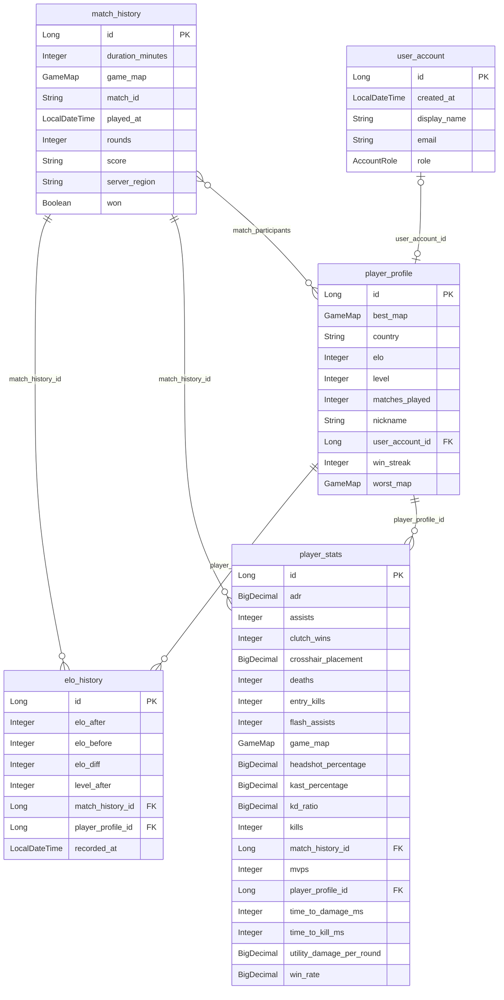

# Schemat bazy danych

Plik generują reguły projektu (panel Maven → Lifecycle → verify). Nie edytujcie go ręcznie.

Tabele: 6 (w tym tabele łączące @ManyToMany: match_participants) · kolumny: 52 · relacje: 4 × @ManyToOne, 3 × @OneToMany, 1 × @OneToOne, 2 × @ManyToMany

| Tabela | Encja | Kolumny | Klucze obce |
|---|---|---|---|
| elo_history | EloHistory | 8 | match_history_id, player_profile_id |
| match_history | MatchHistory | 9 | — |
| player_profile | PlayerProfile | 10 | user_account_id |
| player_stats | PlayerStats | 20 | match_history_id, player_profile_id |
| user_account | UserAccount | 5 | — |

